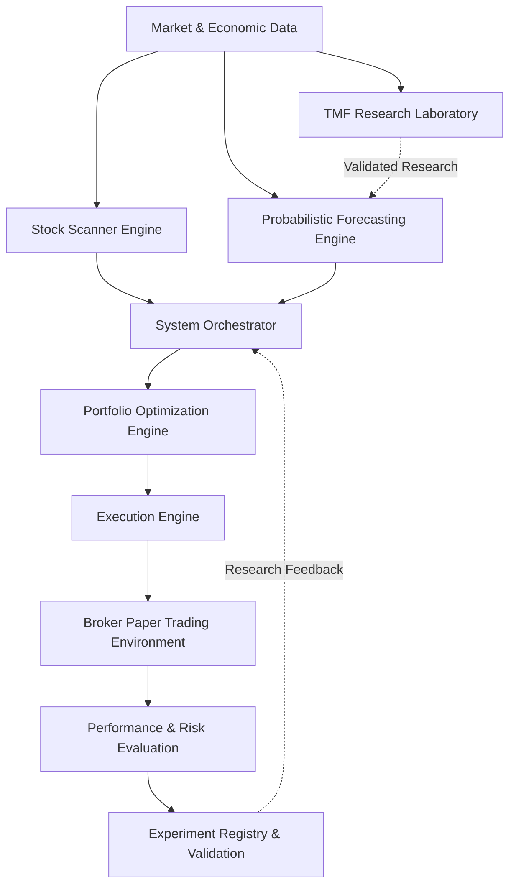
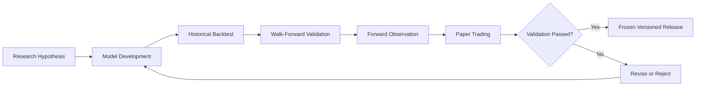

# Systematic Trading Research Platform

**A Modular, Research-Driven Framework for Probabilistic Market Forecasting, Portfolio Optimization, and Trade Execution**

## Project Overview

The **Systematic Trading Research Platform** is an ongoing quantitative finance and software engineering project designed to investigate how statistical modeling, machine learning, probabilistic forecasting, and portfolio optimization can support systematic investment decisions.

The platform consists of independently developed research engines connected through a centralized orchestration repository.

Each engine is designed, tested, and evaluated as an independent experimental procedure before being considered for integration into the broader system.

The long-term objective is to develop a reproducible, risk-aware framework capable of identifying market opportunities, forecasting potential outcomes, optimizing portfolio allocations, and evaluating execution strategies under simulated market conditions.

**Core principle:** Financial markets are inherently uncertain. Rather than attempting to predict a single future price, the platform aims to estimate possible outcomes, their probabilities, and the associated risks.

---

## System Architecture

The top-level orchestrator coordinates the flow of data and decisions across the independent engines. Each engine maintains its own codebase, testing procedures, research documentation, and version history.

### Top-Level Orchestrator

**Repository:** `Systematic-Trading-Research-Platform` — Proposed

The orchestrator serves as the central integration and governance layer for the project.

Its planned responsibilities include:

- Managing engine dependencies through Git submodules and version-pinned releases.
- Coordinating scanner, forecasting, optimization, and execution workflows.
- Enforcing standardized data contracts between engines.
- Maintaining an experiment registry and model validation history.
- Performing cross-engine integration and regression testing.
- Tracking paper-trading results, model performance, and risk.
- Maintaining reproducible configurations and auditable decisions.

The orchestrator is not intended to contain the underlying forecasting or optimization algorithms. These remain independently developed and validated.

---

## Research Engines

### 1. Stock Scanner Engine

**Status:** Active Development

**Objective:** Identify and rank securities based on market conditions, quantitative factors, and investment opportunity characteristics.

Research and development areas include:

- Historical market data ingestion and quality validation.
- Equity-universe eligibility and coverage testing.
- Momentum, volatility, liquidity, and technical indicators.
- Market regime and sector-relative analysis.
- Security ranking and candidate generation.
- Out-of-sample evaluation of predictive factors.

**Current research finding:** The initial data ingestion audit reported successful downloads for 503 securities, with 499 meeting the first-stage eligibility requirements. Four securities were excluded for insufficient historical observations.

This establishes an initial foundation for research, but does not yet demonstrate predictive accuracy or investment profitability.

### 2. Portfolio Optimization Engine

**Status:** Active Development

**Objective:** Translate investment opportunities and risk estimates into portfolio allocation decisions.

Research areas include:

- Maximum Sharpe ratio optimization.
- Asset allocation constraints.
- Covariance and correlation modeling.
- Portfolio concentration and diversification.
- Rebalancing schedules.
- Transaction-cost and turnover analysis.
- Scenario-based portfolio risk.

**Current research finding:** A maximum-Sharpe allocation parity test reproduced the historical reference weights within the specified numerical tolerance, with a reported maximum absolute difference of zero.

This validates consistency for the tested implementation, not the future investment performance of the allocation strategy.

Further development focuses on execution timing, rebalance semantics, and simulation of portfolio transitions.

### 3. TMF Intraday Predictive Analytics

**Repository:** `TMF-Intraday-Predictive-Analytics`

**Status:** Active Research

**Objective:** Investigate the relationship between long-duration Treasury market dynamics, macroeconomic conditions, technical indicators, and the price behavior of the Direxion Daily 20+ Year Treasury Bull 3X Shares ETF (TMF).

Research areas include:

- Treasury yields and interest-rate sensitivity.
- Macroeconomic regime classification.
- Technical momentum and volatility indicators.
- Feature engineering and forward-return analysis.
- Directional signal generation.
- Thinkorswim strategy and study development.
- Historical backtesting and prospective validation.

**Current research finding:** Initial feature analysis across 1,255 daily observations identified relatively weak linear relationships between individual technical features and subsequent five-day returns. For example, log volume showed a Pearson correlation of approximately 0.093.

These preliminary findings suggest that simple individual technical factors may have limited explanatory power and motivate further investigation of nonlinear relationships, interactions, and regime-dependent models.

### 4. Probabilistic Return Forecasting Engine

**Status:** Proposed Research

**Objective:** Estimate conditional probability distributions of future security returns rather than relying exclusively on deterministic price targets.

The proposed forecasting framework is:

\[
P(R_{i,t+h}\mid X_t)
\]

Where:

- \(R_{i,t+h}\): Future return for security \(i\) over horizon \(h\).
- \(X_t\): Information available at the forecast date.
- \(P\): Conditional probability distribution.

Candidate methodologies include:

- Monte Carlo simulation.
- Bayesian inference and updating.
- Quantile regression.
- Gradient-boosted machine learning.
- Regime-switching models.
- Student-t and heavy-tailed distributions.
- Jump-diffusion processes.

Models will be evaluated using calibration, proper scoring rules, out-of-sample performance, and risk metrics.

**Research inspiration:** Work in quantum mechanics and AI-assisted materials modeling provides a conceptual analogy for representing uncertainty through probability distributions. The financial framework uses established statistical forecasting methods, not quantum-mechanical laws to predict asset prices.

### 5. Execution Engine

**Status:** Planned

**Objective:** Convert approved portfolio decisions into controlled, auditable simulated orders.

Planned capabilities include:

- Order construction and validation.
- Market-hours and trading-calendar checks.
- Limit and market order handling.
- Order state tracking.
- Duplicate-order prevention.
- Position and cash reconciliation.
- Execution-quality measurement.
- Broker simulation and paper-trading integration.

Execution strategies must be tested against actual broker-simulator behavior before being considered validated.

---

## Scientific Research and Experimental Methodology

The platform adopts a structured experimental approach to quantitative finance.

Each model begins with a defined hypothesis, followed by feature development, historical evaluation, out-of-sample testing, and prospective validation.

### Research principles

**Reproducibility:** Models are associated with fixed code versions, data definitions, parameters, and evaluation procedures.

**Out-of-sample validation:** Research results are evaluated on observations excluded from model fitting and selection.

**Probability calibration:** Predicted probabilities are compared with realized event frequencies to assess forecast reliability.

**Risk-aware evaluation:** Models are evaluated on downside exposure, drawdown, turnover, transaction costs, and expected shortfall—not returns alone.

**Controlled model promotion:** Passing historical tests does not automatically qualify a model for integration. Prospective testing and paper-trading evidence are required.

**Model versioning:** Validated releases are frozen and versioned. Further experimentation occurs in subsequent model versions.

Paper-trading results are evidence of simulated operational performance, not proof of live-trading profitability.

---

## Research Directions

The platform is investigating several broader questions:

1. Can probabilistic forecasting improve the quality of investment decisions compared with deterministic return predictions?
2. Do market-regime-dependent models produce better-calibrated forecasts than static statistical models?
3. Can combining macroeconomic, technical, and fundamental factors improve out-of-sample forecasting?
4. How do forecast uncertainty and tail-risk estimates influence portfolio construction?
5. Can independent model validation and version-controlled orchestration reduce operational errors and research overfitting?
6. How closely do historical execution assumptions correspond to paper-trading outcomes?

These are research questions, not established conclusions.

---

## Technology Stack

| Category | Technologies |
|---|---|
| Programming | Python, SQL |
| Data analysis | pandas, NumPy |
| Machine learning | scikit-learn, XGBoost (planned) |
| Statistical modeling | SciPy, statsmodels, PyMC (planned) |
| Visualization | Matplotlib, Power BI |
| Testing | pytest, GitHub Actions |
| Version control | Git, GitHub, Git submodules |
| Trading research | Thinkorswim, paperMoney |
| Documentation | GitHub, Obsidian, Notion |
| Future integration | APIs, structured data contracts |

---

## Development Roadmap

| Phase | Deliverable | Status |
|---|---|---|
| 1 | Market-data ingestion and scanner infrastructure | In progress |
| 2 | Portfolio optimization and rebalance simulation | In progress |
| 3 | Top-level orchestrator and integration contracts | Planned |
| 4 | Probabilistic forecasting experiments | Proposed |
| 5 | Execution engine and broker simulation | Planned |
| 6 | Cross-engine paper-trading validation | Planned |
| 7 | Frozen model releases and integrated platform validation | Future |

The roadmap is iterative. Each engine can progress independently, but system-level releases require compatible, validated engine versions.

---

## Research Documentation

Detailed research notes, mathematical assumptions, experiment results, model limitations, and architectural decisions are maintained separately from the production-oriented code.

- **GitHub:** Source code, versioned documentation, tests, and releases.
- **Obsidian:** Research notes, mathematical derivations, and literature analysis.
- **Notion:** Project planning, experiment tracking, and research summaries.

Published results should be traceable to their source datasets, code revisions, and evaluation methods.

---

## Project Status and Disclaimer

This platform is an independent research and engineering project under active development.

Reported findings are preliminary and limited to their documented experiments. Models may be revised or rejected as new evidence becomes available.

No claim is made that the platform currently generates reliable investment profits or that historical performance predicts future returns.

**The primary objective is to develop a scientifically testable, reproducible, and modular quantitative investment research framework.**
